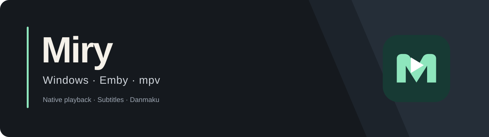

# Miry

  <strong>面向 Windows 的现代 Emby 桌面客户端，原生 mpv 播放，多服务器与独立 Mini 小窗。</strong>

  <a href="https://github.com/Lomiry/Miry/releases/tag/v1.0.8">下载 v1.0.8</a> ·
  <a href="CHANGELOG.md">更新日志</a> ·
  <a href="BUILDING.md">构建说明</a> ·
  <a href="LICENSE-SCOPE.md">许可证说明</a>

  
  
  

连接自己的 Emby 服务器，用原生 mpv 在 Windows 上观看电影、电视剧和动画。Miry 将多服务器浏览、智能片源选择、Smart Route 多线路、主次字幕与 DandanPlay / LogVar 多来源弹幕集中到现代桌面界面，支持独立 Mini 播放器和中英文切换。

## 下载 Miry v1.0.8

- [**Windows x64 安装版**](https://github.com/Lomiry/Miry/releases/download/v1.0.8/Miry_1.0.8_x64-setup.exe)
- [**Windows x64 Portable**](https://github.com/Lomiry/Miry/releases/download/v1.0.8/Miry_1.0.8_x64-portable.zip)
- [**查看本版更新日志**](https://github.com/Lomiry/Miry/releases/tag/v1.0.8) · [全部历史版本](https://github.com/Lomiry/Miry/releases)

两种版本均包含 mpv 运行资源。安装版提供安装与卸载流程；Portable 解压后即可运行，但可能与安装版共享用户配置，切换前请先备份并退出正在运行的 Miry。缺少 WebView2 时，安装引导可能需要联网。

Windows 安装程序未进行 Authenticode 签名，可能显示“未知发布者”；下载后可对照 [SHA256 清单](https://github.com/Lomiry/Miry/releases/download/v1.0.8/SHA256SUMS.txt) 校验文件。[安装、升级与校验说明](docs/releases/README.md)

## 项目亮点

| 特性             | 使用体验                                                         |
| ---------------- | ---------------------------------------------------------------- |
| 原生播放         | 独立 mpv 播放，支持直放、转流、转码与 HLS                        |
| 多服务器媒体库   | 跨服务器分组搜索，支持分页与无限滚动浏览                         |
| 智能片源         | 分辨率或码率优先，支持手动选源及字幕、音轨预选                   |
| 主字幕 / 次字幕  | 双字幕同时显示，在统一入口调整轨道、样式与偏移                   |
| 多来源弹幕       | 内置 DandanPlay，支持 LogVar、自定义兼容来源、手动匹配与失败回退 |
| 独立 Mini        | 小窗持续播放，主窗口继续浏览；支持倍速、缩放与置顶               |
| Smart Route      | 多线路优先级、手动锁定、身份验证与逐线路 SSL 设置                |
| Windows 桌面界面 | 中英文切换、浅色 / 深色 / 系统主题、系统托盘与可定制控制栏       |

支持跨服务器聚合搜索、媒体库排序、筛选、分页与无限滚动，收藏、待看清单和观看记录方便下次继续观看。功能迭代见[更新日志](CHANGELOG.md)。

## 快速开始

1. 打开 Miry，添加自己的 Emby 服务器并登录账号。
2. 在首页或媒体库选择作品，按需选择媒体版本后播放。
3. 在播放器中选择主字幕 / 次字幕，使用在线匹配或加载本地弹幕，并切换合适的画面模式。

[查看使用说明](docs/getting-started.md)，了解媒体库操作、弹幕与隐私相关说明。

## 从源码构建

完整应用源码位于 [source/](source/)。[构建说明](BUILDING.md)提供依赖安装、运行时恢复及 PUBLIC 无凭据构建入口。

## 文档导航

| 文档                                | 内容                                 |
| ----------------------------------- | ------------------------------------ |
| [使用说明](docs/getting-started.md) | 连接服务器、媒体库、字幕、弹幕与隐私 |
| [构建说明](BUILDING.md)             | 开发环境与源码构建                   |
| [许可说明](LICENSE-SCOPE.md)        | MIT 适用范围与文件级例外             |
| [已知问题](docs/known-issues.md)    | 搜索排序、演示模式与问题反馈         |
| [兼容性说明](docs/compatibility.md) | Windows 安装、播放环境与设备适配     |
| [更新日志](CHANGELOG.md)            | 各版本功能变化                       |
| [文档目录](docs/README.md)          | 安装校验、第三方源码与更多资料       |

## 项目与许可

Miry 是个人维护的第三方客户端，媒体来自你有权访问的 Emby 服务器。兼容性、已知问题及许可范围请参阅对应文档；MIT 仅适用于有权许可的自有材料，第三方及文件级例外保留原许可。

[v1.0.8 第三方许可及对应源码](https://github.com/Lomiry/Miry/blob/v1.0.8/docs/third-party/v1.0.8/THIRD-PARTY-SOURCES.md)
