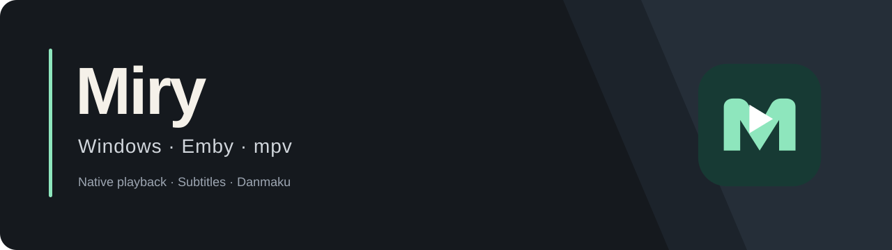

# Miry

  
  
  
  

<strong>Windows 上的 Emby 桌面观看体验</strong> 个人维护 · 非商业 · v1.0.6

  <a href="#功能特性">功能特性</a> ·
  <a href="#下载与版本">下载与版本</a> ·
  <a href="CHANGELOG.md">更新日志</a> ·
  <a href="#在线弹幕">在线弹幕</a> ·
  <a href="#反馈与建议">反馈与建议</a> ·
  <a href="#隐私与使用说明">隐私与使用说明</a>

---

Miry 是一款面向 Windows 的第三方 Emby 桌面客户端，使用原生 mpv 作为播放核心，专注于电影、电视剧和动画的桌面观看体验。

连接自己的 Emby 服务器，浏览媒体库、选择媒体版本、调节字幕与弹幕，并同步播放进度。Miry 本身不提供影视资源或服务器账号。

## 功能特性

| 功能 | 说明 |
| --- | --- |
| 服务器管理 | Emby 服务器连接、多服务器管理与切换 |
| 原生播放 | Windows 原生 mpv 播放，支持 Direct Play / Direct Stream / Transcode / HLS |
| 媒体版本 | 在同一作品的多个媒体版本之间选择 |
| 字幕 | 主字幕 / 次字幕，字幕大小与位置实时调节 |
| 本地弹幕 | 加载本地 Bilibili XML / ASS 弹幕 |
| 在线弹幕 | 作品搜索、自动 / 手动匹配与只读弹幕展示 |
| 搜索 | 首页与媒体库影视搜索、中文输入与清空恢复 |
| 媒体库排序 | 七种排序字段，独立升序/降序切换；搜索排序取决于服务器支持 |
| 每页数量 | 默认 30，支持 20/30/50/100 与自定义 10–200；重启保留偏好 |
| 分页跳转 | 输入页码，Enter或按钮直接跳转，保留筛选与搜索上下文 |
| 观看管理 | 播放进度同步、收藏、待看清单与观看记录 |
| 多线路 | Smart Route 多线路切换 |
| 界面 | Dark / Light / System 主题、UI 字号与可折叠侧栏 |
| Windows 集成 | 系统媒体控制、正式安装程序与手动版本检查 |

## 下载与版本

[安装说明、全部历史版本 SHA256、第三方源码与许可证](docs/releases/README.md)（含v1.0.0历史源码供应缺口）。

| 项目 | 当前状态 |
| --- | --- |
| 平台 | Windows |
| 当前版本 | Miry v1.0.6 |
| 发布状态 | Stage G Release · RELEASED |
| 主要发行形式 | Windows NSIS 安装程序 |
| 项目性质 | 个人维护、非商业；源码可查阅，许可按文件范围适用 |

Miry v1.0.6 已正式发布：[版本说明](https://github.com/Lomiry/Miry/releases/tag/v1.0.6) · [下载 Windows 安装程序](https://github.com/Lomiry/Miry/releases/download/v1.0.6/Miry-Setup-v1.0.6.exe)。

安装程序 SHA256：9061a7ce6a8c7304b57b27b8ba517b5ed890da7ed9ee9ac42380095d41e15c77。

安装程序包含 mpv 运行时，采用当前用户安装；用户数据保存在独立的 AppData 中。WebView2 缺失时由官方引导程序安装，可能需要联网。

About 中可手动检查新版本并查看发布页面。当前不提供自动下载安装或后台更新。

更新内容见 [更新日志](CHANGELOG.md)。1.0.6 增加四种画面模式，并提供[完整应用源码](source/README.md)、PUBLIC 构建入口及第三方材料。许可范围及待证事项见 [RIGHTS-STATUS](source/RIGHTS-STATUS.md)。

本仓库用于项目介绍、开发进度展示和第三方服务接入审核。

## 在线弹幕

Miry 已完成弹弹play开放弹幕网络的接入实现，用于作品搜索、自动/手动匹配以及只读弹幕展示。

发布版已内置接入，无需用户导入服务配置。既有版本的正式作品搜索、电影弹幕样本及原生绘制和时钟同步已通过验证；本版本官方只读签名验证已通过，正式安装包内置服务的首启/重启仍未实机验证，不保证所有电影、电视剧都有可匹配的弹幕。

在线弹幕通过弹弹play官方开放 API 接入，不使用网页抓取、Cookie 模拟或非公开接口。

Miry 不提供弹幕发送、弹弹play用户登录、批量弹幕下载或社区功能。

## 已知限制

- 当前 Windows 安装程序未签名，SmartScreen 可能提示警告。
- 搜索排序仅在服务器支持时生效；当前已测试服务器的文本搜索评分升降序不生效，若顺序不变，可在媒体库中筛选并排序。
- 本版本正式安装、覆盖升级、配置保留和卸载、完整 Windows 界面、内置在线弹幕首启/重启、真实 Emby 服务器，以及完整物理 DPI、多屏和系统主题矩阵仍为 Not Verified；多服务器、200 条性能和全部排序字段/同值跨页覆盖也未完整验证。
- 演示模式尚未完整覆盖新增排序字段；返回历史页面会恢复并保存当时的每页数量。
- 真实远程 Emby、长时间播放及部分 HDR / Dolby Vision / AVR / DPI 环境仍需实机验证。
- Miry 不修改 Windows 显示器刷新率，也不自动切换 Windows HDR。

## 反馈与建议

使用问题与功能建议可以通过 [GitHub Issues](https://github.com/Lomiry/Miry/issues) 提交。

请说明遇到问题时的操作步骤、Miry 版本和预期行为，以便定位问题。

## 隐私与使用说明

### 隐私

Miry 不会向弹幕服务发送 Emby Token、服务器地址、用户账号、媒体服务器凭据或播放历史。

在线匹配仅使用作品标题、年份、季集信息及服务支持的作品 ID。

### 媒体来源

Miry 展示和播放的媒体来自用户自行配置的 Emby 服务器。本应用不托管或分发影视内容；请使用自己有权访问的媒体服务和内容。

## License

[完整应用源码](source/README.md)现按明确许可范围提供。MIT 只适用于有权许可的 Miry 自有材料；291 项继承路径权属仍待证，第三方与文件级例外保留原许可。见 [MIT](source/LICENSE)、[精确范围](source/LICENSE-SCOPE.json)、[第三方材料](docs/third-party/v1.0.6/THIRD-PARTY-SOURCES.md)与[待证披露](source/RIGHTS-STATUS.md)。不宣称全应用已获 MIT 清权。
